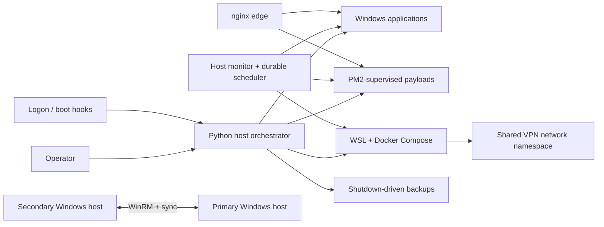

# System Overview

Status: current-state summary and reusable architecture pattern.

## What was built

The homelab uses two Windows machines with deliberately different roles:

- the **primary host** runs the media stack, edge proxy, automation control
  plane, monitoring, backups, and a WSL-based Docker stack;
- the **secondary host** is usually offline and runs only the synchronization
  and activity-reporting components it needs when it is available.

Local aliases are used in the implementation, but the handbook uses role names
so the design remains understandable and reusable. Fixed private addresses and
service ports belong in a local inventory, not in conceptual chapters.

## Control plane and payloads

The most important boundary is between coordination and application code.

The Python host orchestrator is the control plane. It owns host profiles,
environment validation, startup and shutdown phases, process-group lifecycle,
container readiness, scheduled-task policy, and backup routing. Stable batch
files remain as compatibility entrypoints for shortcuts and Windows hooks, but
they delegate meaningful work to Python.

PM2 remains a supervisor for a small number of Node and Python payload
applications. It is not the system-wide scheduler. Docker Compose owns the
container graph. Windows Task Scheduler is reserved for boot, logon,
elevation, `SYSTEM`, or availability boundaries that a normal user process
cannot cross reliably.

## Runtime sequence

Startup is phased rather than time-based:

1. Validate mounts and required runtime configuration.
2. Start the edge and core Windows services.
3. Cross the elevation boundary through a narrow scheduled-task bridge.
4. Start core and media payload groups.
5. Start the VPN-isolated container stack and wait for health and LAN
   forwarding readiness.
6. Start the host monitor, even in a documented degraded mode when optional
   container services are unavailable.

Shutdown reverses ownership rather than blindly reversing startup. It stops
traffic-producing components, runs bounded cleanup and policy work, executes
due backup tiers, performs final synchronization, records the result, and
clears runtime flags. A guard caps the total preshutdown duration so a failed
helper cannot block power operations indefinitely.

## Recurring work

Recurring application maintenance runs inside the long-lived host monitor. A
SQLite ledger preserves run history and retry state across restarts. Jobs have
operating windows, startup grace, resource leases, hard timeouts, explicit
deferrals, bounded retry behavior, and failure/recovery notifications.

This avoids scattering related work among invisible scheduled tasks. Windows
Task Scheduler still performs the few jobs that need a machine trigger,
privileged identity, or an independent recovery path.

## Network boundaries

The public edge and the download stack use different protection mechanisms:

- nginx exposes selected services, terminates or screens traffic, and applies
  authentication and generated access policy;
- network-sensitive containers share a VPN container's network namespace, so
  they have no independent route around its firewall;
- only selected management endpoints are forwarded back to the trusted LAN;
- client peer ports are mapped on the VPN side rather than exposed through the
  Windows host;
- remote administration between trusted Windows hosts uses WinRM and explicit
  host identity.

These controls are layered. Geographic filtering is a noise-reduction policy,
not an authentication substitute, and VPN routing is not a replacement for
application credentials.

## State and observability

The design favors inspectable state over implicit process memory:

- declarative host profiles and process registries;
- a tracked service contract for container endpoints and groups;
- JSON status files for bounded lifecycle operations;
- a SQLite ledger for recurring jobs;
- file flags for a small set of operator overrides;
- structured HTTP status for the host monitor;
- explicit log ownership and retention rules.

Dry-run, validation, doctor, inventory, and status commands are part of the
operating model. They are not optional developer conveniences.

## Storage and recovery

Backups are driven by preshutdown because that is when applications can be
quieted consistently. A frequent local mirror provides short-term recovery,
while less frequent encrypted archives feed durable and external copies.
Retention only removes an older archive after the replacement passes basic
existence and size checks.

Synchronization and backup are treated as separate concerns. A synchronized
deletion can propagate; a backup is expected to preserve a recoverable prior
state.

## Principles extracted from the implementation

1. Keep one control plane for lifecycle policy.
2. Use declarative registries and contracts, then validate them before action.
3. Prefer readiness checks over fixed sleeps.
4. Bound every wait and long-running subprocess.
5. Preserve enough durable state to explain what happened after a restart.
6. Model temporary operating conditions as deferrals, not failures.
7. Degrade explicitly when optional dependencies are absent.
8. Keep privilege crossings narrow and observable.
9. Separate synchronization, short-term mirrors, and durable backups.
10. Document retired paths so operators do not accidentally revive them.

