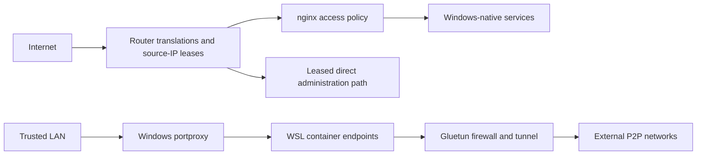

# Firewall and Exposure Automation

Status: current-state architecture, risk record, and improvement plan.

## Scope

There is no single homelab firewall. Exposure is controlled by several systems
with different responsibilities:

| Plane | Responsibility | Current mechanism |
| --- | --- | --- |
| Internet edge | Decide which router translations are enabled and who may use them | Typed router-rule automation with source-IP leases |
| Automatic mappings | Inventory or disable mappings created by LAN applications | Router UPnP API |
| Application edge | Authenticate, filter, rate-limit, and deny clients | nginx plus the administrative application |
| Windows-to-WSL boundary | Publish selected container UIs to the trusted LAN | Contract-driven portproxy and Windows Firewall rules |
| Container egress | Prevent P2P workloads from bypassing the VPN | Gluetun firewall and shared network namespace |
| Windows host | Filter traffic at each Windows machine | Currently disabled by explicit local policy |

The word *firewall* in command names usually refers to router port mappings,
not Microsoft Defender Firewall. Documentation and status output should always
name the enforcement plane.

## Router rule controller

The administrative application talks directly to the router's authenticated
JSON management interface. Credentials remain in the process environment and
must never appear in handbook examples or logs.

Before a rule can be changed, the controller finds exactly one mapping that
matches its declared identity:

- rule name;
- internal destination;
- internal and external ports or range;
- allowed protocol set.

The implementation does not blindly trust a historical numeric router rule ID.
It discovers and validates the rule, then caches the returned identifier for
the active controller instance. Zero or multiple matches stop the mutation.

Opening access for an address performs two router changes in order:

1. validate the supplied IPv4 address and write it as the rule's remote-source
   restriction;
2. enable the rule.

Each mutation records a best-effort before snapshot, the requested action, an
after snapshot, duration, and any error. A stale router session is cleared and
retried once; unrelated failures are returned to the operator.

## Temporary RDP and media leases

RDP and the media-administration port range can be opened to one caller address
for a selected time-to-live. Both the web interface and notification bot use
the same typed command runtime.

The successful flow is:

1. derive or accept the caller's IPv4 address;
2. validate and open the expected router mapping for that address;
3. for media administration, start and probe the nginx listener;
4. store the allowed address and expiry in a versioned lease file;
5. atomically replace the prior lease file;
6. arm an in-process auto-close timer;
7. expose the rule, address, and deadline through status;
8. disable the router rule at expiry and clear the durable lease;
9. notify the operator of automatic closure.

The lease file uses a temporary file plus rename and is restricted when the
platform honors its requested file mode. It stores no router password.

### Restart reconciliation

At administrative-service startup, persisted leases are loaded before the HTTP
listener becomes available:

- an expired lease causes the router rule to be disabled immediately and the
  lease to be cleared;
- a future lease re-arms the timer for its original deadline;
- a lease without an expiry remains open by policy;
- malformed state prevents the admin listener from starting.

This turns process restart into reconciliation rather than silently extending
temporary access.

### Current failure gaps

Two cases need hardening:

1. If an auto-close router mutation fails, the service logs and notifies the
   failure but does not retry or re-arm the timer. The expired durable lease
   remains, so a later service restart will try to close it, but the live rule
   may otherwise remain open until manual action.
2. Media publication opens its router mapping before it starts and probes
   nginx. If nginx startup or readiness fails, the command reports that the
   router rule was opened, but it does not roll the rule back or persist the
   expiry lease. This can leave exposure open without an automatic close.

Until fixed, the operator response to either alert is to inspect the router rule
directly, close it explicitly, and verify the final rule snapshot.

## Coordinated Plex publication

Plex remote access coordinates application state with its router mapping.

Enable follows an open-then-publish sequence. If the application publication
step fails, the router rule is closed as rollback and both the primary and
rollback outcomes are reported.

Disable attempts both sides even if one fails: it asks Plex to stop publishing
and independently tries to close the router rule. The result reports an
incomplete transition rather than claiming success when only one side changed.

This is the strongest current transaction pattern and should become the model
for media-administration exposure.

## Router UPnP administration

UPnP control inventories the router feature state, advertisement settings, and
automatic mapping leases. Reads and mutations from the two operator interfaces
share a machine-local lock.

Disabling is intentionally destructive:

1. snapshot current state;
2. delete mappings whose creator is UPnP;
3. disable the router feature while preserving its advertisement settings;
4. read the state back;
5. verify that the feature is disabled and no automatic mappings remain.

If mapping deletion succeeds but the setting change fails, the operation is
reported as an incomplete mutation. Re-enabling UPnP does not recreate deleted
mappings; each client must request them again. Therefore disable is never a
health-check action.

## nginx-generated policy

The edge has two generated access-policy paths.

### Geographic allowlists

Country data is transformed into immutable releases. A candidate is activated
only after the complete nginx configuration validates. Edge and P2P filters
consume the same release manifest so their policy cannot silently diverge.

This reduces unsolicited traffic but is not an authentication control.

### Administrative login bans

Repeated failed logins are persisted by source IPv4 address. Once the threshold
is reached, the address is rendered into an nginx deny include. The include is
written atomically, the complete configuration is tested, and nginx is
reloaded. If validation or reload fails, the prior include is restored.

The deny include precedes geographic allow rules and is used by every relevant
HTTP and stream listener. Removal is deliberately a local administrative
operation.

## Windows-to-WSL publication

The container service contract declares the LAN endpoints and targeted service
groups. When a group starts, an elevated helper:

1. removes any prior managed portproxy and firewall rule for the selected
   endpoints;
2. discovers the current WSL IPv4 address;
3. creates the required TCP port proxies;
4. creates named inbound Windows Firewall allow rules scoped to the declared
   listen address, port, and trusted local subnet.

Targeted stop removes only the managed proxies and rules for that group. Health
monitoring later verifies that proxies still point to the current WSL address.

## Windows Firewall posture

The current site policy disables the Domain, Private, and Public Microsoft
Defender Firewall profiles. A privileged network watchdog checks this alongside
adapter identity, static addressing, DNS, IPv6, and related settings, and
restores the disabled state after drift. A separate script suppresses Windows
Security notifications about that decision.

Consequences:

- router, nginx, application authentication, and service bind addresses carry
  more of the security burden;
- a process listening unexpectedly on a LAN interface is not contained by the
  host firewall;
- the LocalSubnet rules created for WSL publication are present but do not
  enforce isolation while all profiles are disabled;
- changing this policy requires coordinated rule inventory and testing before
  enabling the profiles.

This is a site-specific trusted-LAN decision, not a recommended default. The
portable handbook baseline should keep host firewalls enabled with narrowly
scoped rules.

## Container firewall

P2P consumers share Gluetun's network namespace and therefore its firewall and
tunnel route. IPv6 is disabled, application peer ports are allowed only on the
VPN interface, and management ports are limited to the LAN-facing path.
Persisted client binding provides an additional check against accidental tunnel
bypass.

VPN port-forward failures are diagnostic and retried independently. They do not
cause a healthy tunnel to be recycled. Recovery is reserved for sustained,
confirmed gateway failure and uses cooldown and attempt limits.

## Read-only inspection order

For an exposure audit:

1. Read the router snapshots for RDP, media administration, Plex, and UPnP.
2. Compare open rules with durable lease state and expiry.
3. Confirm the intended nginx listener and complete configuration test.
4. Inspect generated deny and allow release status without printing client
   addresses.
5. Compare the service contract with Windows portproxy and managed rule names.
6. Check whether Windows Firewall profiles are enabled before interpreting the
   effect of their rules.
7. Verify container namespace and VPN firewall health.
8. Report mismatches by enforcement plane and do not mutate them during a
   read-only audit.

## Hardening backlog

Recommended order:

1. Roll back the media router rule if nginx startup or readiness fails.
2. Persist the intended expiry before the first exposure mutation, or use a
   small transaction record that distinguishes pending, open, and closed.
3. Retry failed auto-close operations with bounded backoff and an escalation
   deadline.
4. Add one reconciler that compares router truth, durable leases, and listener
   readiness on every service start and periodically afterward.
5. Decide whether to retain the Windows-firewall-off policy. If not, first
   inventory all listeners and generate a tested least-privilege ruleset.
6. Expose a unified, redacted status showing each enforcement plane and the
   reason every external path is open.
7. Add failure-injection tests for router success followed by listener failure,
   lease-write failure, timer failure, and restart during each transition.

